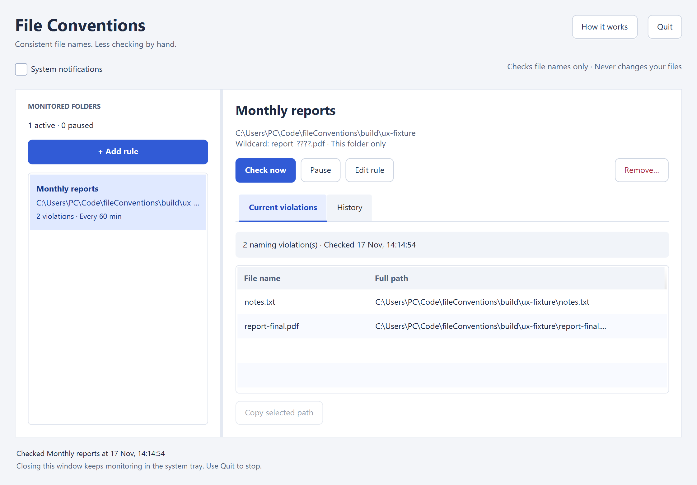

  
  <h1>File Conventions</h1>
  
Get notified when file names break your naming rules.

  [Download](https://github.com/PatrikTrefil/fileConventions/releases/latest) · [Report a problem](https://github.com/PatrikTrefil/fileConventions/issues)

  

**Spend less time checking file names by hand.** File Conventions is a small desktop app for **Windows, macOS, and Linux** that watches the folders you choose and alerts you when a file name breaks your rules.

Keep monthly reports predictable (`report-2026.pdf`), invoices easy to find (`invoice-2026-001.pdf`), or shared project folders consistent. Describe what a valid name looks like; the app lists the exceptions so you can fix them in your file manager. **It never renames, deletes, or changes your files, and does not read their contents.**

- **Use the folders you already work in.** Monitor local folders, mounted network drives, and Google Drive folders available through your desktop sync client. Just choose a folder your computer can access.
- **Runs fully locally.** Checks, rules, and results stay on your computer. No File Conventions account, cloud service, or file uploads are needed. Your existing network or cloud software handles access and syncing.

## Get started in a minute

1. [Download the latest release](https://github.com/PatrikTrefil/fileConventions/releases/latest): `.exe` for Windows, `.dmg` for macOS, or `.deb` for Debian/Ubuntu. Java is included; choose the asset for your architecture.
2. Open the app and select **Add your first rule**. Give it a name and choose a folder.
3. Leave the pattern type on **Wildcard (simple)** and try `report-????.pdf`. In **Try a file name**, enter `report-2026.pdf` to see a match, or `notes.txt` to see a violation. Patterns describe names you **allow**.
4. Set a checking interval and select **Save rule**. The first check starts automatically. Select the rule to see **Current violations**; **Check now** refreshes immediately.

The welcome panel gives you a quick introduction. **How it works** is always available if you need a reminder. Advanced monitoring options stay out of the way until you need them.

On Windows, **Run File Conventions** is checked by default on the installer's final page. Click **Finish** to launch the app, or uncheck it to launch later.

Otherwise, launch it from your application menu or shortcut. Open it again after signing in: installation does not enable automatic startup.

Installers are unsigned, so Windows or macOS may show an unfamiliar-publisher warning. Linux needs a graphical desktop. Desktop alerts require system tray support and notifications enabled in your OS. Without a supported tray, you can still review results in the open app.

## How it works

- Watches for file-name changes and checks periodically in the background. Rules and notification preferences are saved across restarts.
- Waits 7 seconds after changes by default to let temporary names settle; the delay is adjustable.
- Alerts once per new violation during a session. If the name is fixed and the violation returns, it alerts again.
- Keeps monitoring when you close the window if a system tray is available. Otherwise, keep the window open. Use **Quit** to stop.
- Use **Pause** / **Resume** to control automatic checks for a rule. **Check now** still works as a one-time check while paused. Removing a rule leaves its files untouched.
- Copy a violating file's path with **Copy selected path**, then fix the name yourself. Resolved entries disappear on the next check. Failed scans retain previous successful results with a warning that they may be out of date.
- **Check history** keeps the latest 100 checks for troubleshooting until you quit.

Patterns describe **valid names** and match the entire file name, including the extension, case-sensitively:

| Pattern | Valid example |
| --- | --- |
| Wildcard: `report-????.pdf` | `report-2026.pdf` |
| Regex: `invoice-[0-9]{4}-[0-9]{3}\.pdf` | `invoice-2026-001.pdf` |

In wildcards, `*` means any number of characters and `?` means exactly one character (not necessarily a digit). Use a regular expression for stricter rules such as digits only. The editor's filename tester shows whether a sample is allowed before you save.

Only regular files in the selected folder are checked; folders and symbolic links are skipped. **Include files in subfolders** is off by default. Enable it for recursive checks. Patterns match names, not paths or contents.

Network and Google Drive folders must be mounted or synced, readable, and exposed as regular filesystem folders; the app does not connect to the Google Drive website or API. Remote changes may appear only after syncing and the next periodic check, since filesystem change events vary by provider. See [usage and troubleshooting](docs/usage.md) for details.

[Usage and troubleshooting](docs/usage.md) · [Build and release instructions](docs/development.md)
